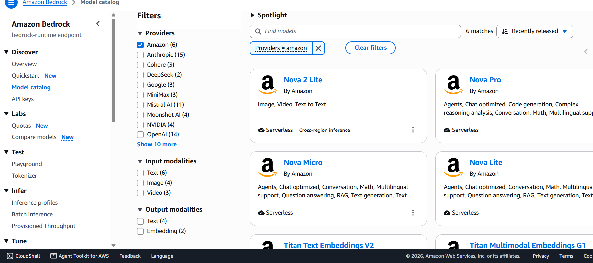
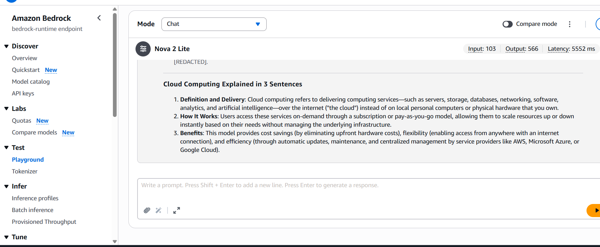
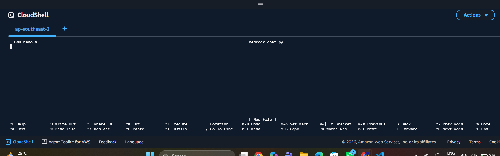
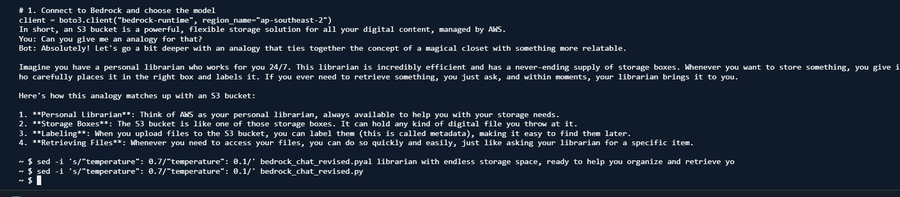
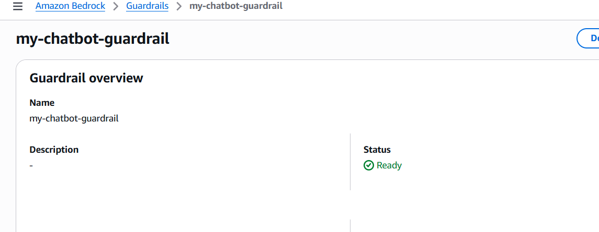

# AWS Bedrock AI Chatbot

A Python terminal-based conversational chatbot built while following the [NextWork Build an AI Chatbot with Amazon Bedrock project](https://nextwork.ai/projects/5a33756f-a675-5a80-9738-048dc500cabc?track=high).

The project demonstrates making a single request to a foundation model, maintaining multi-turn conversation history, customizing the assistant's behavior with a system prompt and inference parameters, and optionally invoking Amazon Bedrock Guardrails.

## Features

- **Foundation model:** Amazon Nova Lite (`amazon.nova-lite-v1:0`)
- **AWS service:** Amazon Bedrock Runtime using Boto3's `converse` API
- **Region:** Asia Pacific (Sydney), `ap-southeast-2`
- **Conversation memory:** Previous user and assistant messages are sent back with each request, during the current terminal session
- **System prompt:** A friendly cloud-computing tutor that explains concepts simply and uses analogies
- **Inference configuration:** `temperature`, `topP`, and `maxTokens`
- **Optional guardrails:** Bedrock Guardrails, configured with an ID supplied through an environment variable

## Project screenshots

These are screenshots from the AWS Console and CloudShell during the project. Account-specific identifiers have been cropped or hidden where necessary.

### 1. Explore Amazon Bedrock models

Amazon's model catalog in the Sydney region, including **Nova Lite** and **Nova 2 Lite**.



### 2. Test a foundation model in the Playground

The **Nova 2 Lite** model responding to a cloud-computing prompt through Bedrock Playground. **Note:** the Playground demonstration uses Nova 2 Lite; the Python scripts in this repository call the separate **Nova Lite** model (`amazon.nova-lite-v1:0`).



### 3. Make the first Python API call

AWS CloudShell runs `bedrock_chat.py`, successfully returning a model-generated explanation of cloud computing.



### 4. Hold a multi-turn conversation

The chatbot answers a follow-up question about S3 buckets using earlier conversational context and an analogy.



### 5. Create a Bedrock Guardrail

The Bedrock Guardrail overview shows the configured guardrail in **Ready** status. This screenshot verifies creation, **not** that harmful inputs were successfully blocked in a runtime test.



## Project files

| File | Purpose |
| --- | --- |
| `bedrock_chat.py` | Single question and response through the Converse API |
| `bedrock_chat_revised.py` | Interactive multi-turn chatbot (temperature `0.1`) |
| `bedrock_chat_guardrail.py` | Interactive chatbot with guardrail configuration (temperature `0.7`) |
| `requirements.txt` | Python dependency |
| `.gitignore` | Excludes common credentials and local files |
| `screenshots/` | Selected project evidence included in this README |

## Requirements

- Python 3.9 or later and Boto3
- An AWS account with permission to invoke the selected model in Amazon Bedrock
- AWS credentials configured through a supported mechanism (e.g., CloudShell's existing AWS identity, AWS CLI profile, or an IAM role)
- Bedrock model availability and account access for `amazon.nova-lite-v1:0` in `ap-southeast-2`

> **Costs:** Bedrock model inference and guardrail use can incur AWS charges. Review pricing, credits, and billing settings before running.

## Running in AWS CloudShell

Open CloudShell in the AWS Console, using the same region as the scripts. Upload or clone this repository into CloudShell, then run:

```bash
python3 -m pip install -r requirements.txt
python3 bedrock_chat.py
python3 bedrock_chat_revised.py
```

The interactive chatbot starts with `Chatbot ready! Type 'quit' to exit.` Ask a question such as `What is an S3 bucket?`, then `Can you give me an analogy for that?` Type `quit` to exit.

## Running with a guardrail

First create a Bedrock Guardrail in the **same AWS region** as the script, and make sure the identity running the script has permission to apply it. Set the guardrail ID in the environment rather than committing your account-specific ID to GitHub:

**Linux/macOS / AWS CloudShell:**

```bash
export BEDROCK_GUARDRAIL_ID="YOUR_GUARDRAIL_ID"
python3 bedrock_chat_guardrail.py
```

**Windows PowerShell:**

```powershell
$env:BEDROCK_GUARDRAIL_ID = "YOUR_GUARDRAIL_ID"
python bedrock_chat_guardrail.py
```

The script uses the `DRAFT` guardrail version and requests an enabled trace. You can inspect guardrail behavior in the AWS environment while testing.

## Technical flow

1. Boto3 creates a `bedrock-runtime` client in `ap-southeast-2`.
2. The program sends messages to `amazon.nova-lite-v1:0` using `client.converse`.
3. The model returns a response, which the program prints.
4. In the conversational scripts, the response is appended to in-memory history for the next request.
5. In the guardrail script, a configured Bedrock guardrail is also applied to the request.

## Security notes

- Never commit AWS access keys, credentials files, or secret environment files.
- The guardrail ID is read from `BEDROCK_GUARDRAIL_ID` at runtime; replace `YOUR_GUARDRAIL_ID` with the value from your AWS Console.
- Use IAM permissions appropriate for your learning environment.
- Conversation history is held in Python memory and is not persisted across runs by these scripts.

## Acknowledgment

Built as a hands-on learning project based on NextWork's **Build an AI Chatbot with Amazon Bedrock** tutorial. NextWork's tutorial is the learning reference; this repository contains the learner's Python implementation.
